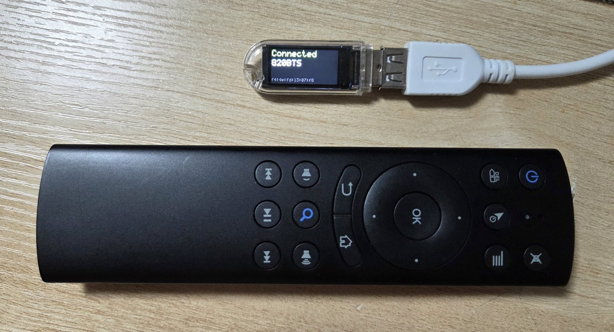
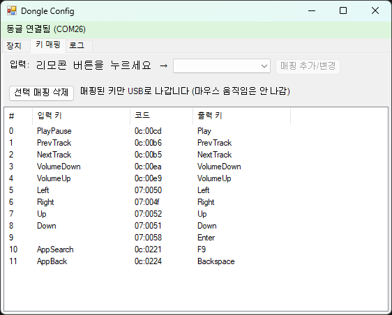

# esp-dongle

*ESP32-S3 USB stick that maps BLE remote buttons to USB keyboard/media keys; the config tool ships on the stick's own USB drive.*

<p align="center"></p>

블루투스(BLE) 리모콘이나 키보드의 버튼을 **원하는 키로 바꿔서** USB 키보드 입력으로 내보내는 USB 스틱.
PC에서 한 번 설정해 두면 Windows, 안드로이드 등 USB 키보드를 인식하는 곳이면 어디에 꽂아도 그대로 동작합니다.

- 예: 안드로이드TV 리모콘의 "뒤로" → `Home`, OK 버튼 → `Enter`, 음성 버튼 → `F13` 등
- 호스트에는 드라이버나 앱 설치가 필요 없음. 스틱은 그냥 일반 USB 키보드로 보임
- 설정 프로그램(`DongleConfig.exe`)이 **스틱 안의 USB 드라이브에 들어 있음**. 따로 받을 필요 없음

## 무엇을 할 수 있나
| | |
|---|---|
| 🔌 꽂으면 바로 동작 | 페어링해 둔 장치에 자동 재연결 (끊겨도 계속 재시도) |
| 🎯 버튼 → 키 매핑 | 버튼 하나 → 키 하나. 키보드 키, 미디어/앱 키(홈, 뒤로, 볼륨 등) 지원. 동시 입력 가능 |
| 🔇 매핑한 키만 출력 | 매핑 안 된 버튼, 자이로 마우스 움직임은 PC로 **아무것도 보내지 않음** |
| 🧩 장치 종류 무관 | 장치의 HID Report Map을 읽어서 해석. 장치별 코드 없이 BLE HID 장치 대부분 지원 |
| 🖥️ 상태 표시 | 0.96" LCD에 연결 상태와 장치 이름 (화면 없는 보드는 RGB LED 색) |
| 🔘 버튼 하나로 페어링 | K1을 누르면 근처 장치를 찾아 가장 가까운 장치와 페어링 |

## 지원 장치
- ✅ **BLE HID 장치**: 안드로이드TV 블루투스 리모콘, BLE 키보드, BLE 셀카 리모콘 등.
  확인한 장치: G20BTS 리모콘 (자이로 마우스 포함)
- ❌ **블루투스 클래식 장치**: ESP32-S3 칩이 BLE만 지원합니다. Windows "디바이스 추가"에는 보여도 이 스틱에서는 검색되지 않습니다 (예: 셀카 리모콘 Beauty-R1).
  구분 방법: `python tool\ble_inspect.py scan`에 나오면 BLE.
- 한 번에 장치 1대만 연결. 새 장치를 페어링하면 이전 장치는 지워집니다.

## 사용법
### 1. 장치 페어링
리모콘을 페어링 모드로 둔 뒤 둘 중 하나:
- 스틱의 **K1 버튼을 짧게 누르기** → 5초 스캔 후 가장 가까운 장치와 페어링
- 스틱의 USB 드라이브에서 `DongleConfig.exe` 실행 → **장치** 탭 → 스캔 → 목록에서 선택 → 페어링

> 그 리모콘이 PC나 TV에 이미 페어링되어 있으면, 그쪽에서 먼저 제거해야 검색됩니다.

### 2. 키 매핑
`DongleConfig.exe` → **키 매핑** 탭 → 리모콘 버튼 누르기 → 출력 키 선택 → 추가. 자동으로 스틱에 저장됩니다.

<p align="center"></p>

이제 스틱을 TV 박스, 다른 PC 등에 꽂아서 쓰면 됩니다. 설정은 스틱에 남아 있습니다.

### 상태 표시 / K1
| LCD 표시 | 화면 없는 보드의 LED | 의미 |
|---|---|---|
| No device / Press K1 to pair | 흐린 흰색 | 저장된 장치 없음 |
| Scanning.. | 청록 | K1 또는 exe로 스캔 중 |
| Searching.. + 장치 이름 | 노랑 | 저장된 장치에 재연결 시도 중 (리모콘 버튼을 누르면 깨어남) |
| Connected + 장치 이름 | 초록 | 연결됨 |

K1은 보드의 BOOT 버튼입니다.

## 하드웨어
ESP32-S3 보드 두 종류를 지원합니다. [릴리즈](../../releases)에서 보드에 맞는 파일을 받아 0x0에 기록하세요.

| 보드 | 릴리즈 파일 | 특징 |
|---|---|---|
| **Pocket-Dongle-S3-0.96** (dongle-s3-0.96) | `firmware-pocket-dongle-s3-0.96.bin` | 케이스 있는 USB 스틱, 0.96" LCD, 16MB flash |
| **ESP32-S3-Zero** (Waveshare) | `firmware-esp32-s3-zero.bin` | 손톱만 한 보드, 화면 대신 RGB LED, 4MB flash. USB-C라 케이블로 연결 |

공통: 네이티브 USB (GPIO19/20), K1 = GPIO0 (BOOT), UART0 로그 GPIO43(TX)/44(RX).
- Pocket-Dongle: ST7735S LCD 80×160 (SCLK 10, MOSI 11, CS 12, DC 13, RST 14), PSRAM 8MB (미사용), TF 슬롯 GPIO15~18, 47, 48
- ESP32-S3-Zero: WS2812 RGB LED GPIO21, PSRAM 2MB (미사용)

> **처음 플래시하기 전에 원래 펌웨어 백업 권장.** K1을 누른 채 꽂아 다운로드 모드로 들어간 뒤:
> `python -m esptool --chip esp32s3 -p COMx read-flash 0 0x1000000 dist\original-flash.bin`
> (16MB 기준. ESP32-S3-Zero는 4MB라 `0x400000`)
> (복구: 같은 파일을 0x0에 `write-flash`. `*.bin`은 gitignore 대상)

---

## 개발자용

### 동작 구조
```
[BLE 리모콘] --BLE HID--> [ESP32-S3] --USB composite 303A:4007--> PC / TV
                                       ├─ HID  키보드(report 1) + 컨슈머/미디어키(report 2)
                                       ├─ MSC  FAT 1MB, DongleConfig.exe
                                       └─ CDC  설정 프로토콜 (exe가 사용)
```
BLE 리포트 → Report Map으로 눌린 키(HID `page:usage`) 추출 → 키맵에 있는 것만 USB HID로 출력.

### 빌드 / 플래시
1. [ESP-IDF v6.1](https://docs.espressif.com/projects/esp-idf/en/v6.1/esp32s3/get-started/windows-setup.html) 설치
   (`git clone -b v6.1 --recursive https://github.com/espressif/esp-idf` 후 `install.ps1 esp32s3`).
   기본 위치는 `%USERPROFILE%\esp\esp-idf-v6.1`이고, 다른 곳이면 `$env:IDF_PATH`를 설정합니다.
2. Python 3.11 + `pip install -r tool/requirements.txt`. 테스트용으로 LLVM clang.
3. 스틱을 꽂고 `.\dev.ps1 flash`. 처음에 안 잡히면 K1을 누른 채 꽂습니다.
   ESP32-S3-Zero는 모든 명령에 `-Board s3zero`를 붙입니다 (빌드 폴더 `firmware/build-s3zero`, 설정 `sdkconfig.defaults.s3zero`, 파티션 `partitions_4mb.csv`).
   동글이 두 개 꽂혀 있으면 `-Port COMx`로 지정하세요.

> `idf.py build`만 쓰면 exe 없이 빈 드라이브로 빌드됩니다. `dev.ps1 build`를 쓰세요.

`dev.ps1` 명령:

| 명령 | 하는 일 |
|---|---|
| `build` | 키코드 생성 → exe 빌드 → 펌웨어 빌드 |
| `flash` | build + 플래시. 포트 자동 탐색, 동글 펌웨어가 돌고 있으면 `dfu`로 다운로드 모드 전환 |
| `monitor` / `all` | 동글 CDC 터미널 (UART 어댑터면 `-Port COMx`) / flash + monitor |
| `test` | `keymap.c` + `hid_parse.c` 호스트 유닛 테스트 (ESP 없이) |
| `ports` | ESP32-S3 포트 / PID (1001 = 다운로드, 4007 = 동글 펌웨어) |
| `erase-nvs` | BLE 본딩 + 키맵만 삭제 |
| `storage` | FAT 파티션(exe)만 다시 쓰기 |
| `coredump` | 마지막 크래시 분석 |
| `dist` | `dist\esp-dongle-<보드>-*.bin` 단일 바이너리 (0x0에 기록, [esptool-js](https://espressif.github.io/esptool-js/) 가능) |
| `menuconfig` | `idf.py menuconfig` |

### 코드 구성
| 경로 | 내용 |
|---|---|
| `firmware/main/main.c` | 저장 장치 재연결, scan/pair/forget, K1, 리포트 → keymap |
| `firmware/main/hid_parse.c` | Report Map 해석, 리포트에서 눌린 키(page:usage) 추출 |
| `firmware/main/keymap.c` | 매핑 + CDC 명령. ESP 의존 없음 → `firmware/test/`에서 PC로 테스트 |
| `firmware/main/usb.c` | USB 디스크립터, HID 출력, CDC, MSC, `dfu` |
| `firmware/main/lcd.c`, `led.c` | 상태 표시: LCD 화면 / 화면 없는 보드는 RGB LED. 보드는 Kconfig `DONGLE_BOARD`로 선택 |
| `firmware/main/keymap_nvs.c` | 키맵 NVS 저장/로드 |
| `firmware/main/esp_hid_gap.*` | IDF 예제의 BLE GAP 헬퍼 (`adv_is_hid()`만 수정) |
| `tool/DongleConfig.cs`, `tool/build.ps1` | 설정 exe (C# WinForms, Windows 내장 `csc.exe`로 빌드, 설치 불필요) |
| `tool/keycodes.json` | 키 이름 단일 소스. `gen_keycodes.py`가 `keycodes.h` / `KeyCodes.cs` 생성 |

### CDC 프로토콜
줄 단위 텍스트, DTR을 켜야 응답합니다. USB CDC라 baud 값은 무관합니다. 응답은 `ok ...` 또는 `err ...`.

| 명령 | 동작 |
|---|---|
| `help` / `ver` / `keys` | 명령 목록 / 펌웨어 버전 / 키 이름 전체 |
| `list` | 매핑 목록: `map <i> <page:usage> <출력키> [입력키 이름]` |
| `map <page:usage\|키이름> <key>` | 매핑 추가. 예: `map c:224 AppHome`, `map 9:1 Enter`, `map AppBack AppHome` |
| `unmap <i>` / `clear` / `save` | 삭제 / 전부 삭제 / NVS 저장 |
| `status` | `ok none\|connecting\|connected <addr> <name>` |
| `scan [초]` | `dev <addr> <addr_type> <rssi> <name>` 줄들 → `evt scan end <n>` |
| `pair <addr> <addr_type>` / `forget` | 장치 교체 / 삭제 (기존 본딩 삭제) |
| `hidmap` | 연결 장치의 Report Map 해석 결과 |
| `inject <rid> <hex>` | BLE 리포트를 받은 것처럼 처리 (테스트/리플레이) |
| `dfu` | 다운로드 모드로 재부팅 |

이벤트 줄:
- 버튼을 누르거나 뗄 때 `key <page:usage> 1|0 [이름]`. 이 page:usage를 `map`에 쓰면 됩니다.
- 그 리포트의 원본은 `rpt <rid> <hex>`.
- 연결 상태가 바뀌면 `evt none|connecting|connected ...`.
- ESP 로그(BLE 연결 실패 이유 등)는 `log <내용>`으로도 나옵니다. exe의 로그 탭에서 볼 수 있습니다 (UART 핀이 없는 보드용).

키 이름 목록은 [tool/keycodes.json](tool/keycodes.json)에 있습니다. 한영 `HanEng`, 한자 `Hanja`, 안드로이드TV `AppHome`/`AppBack`/`Menu*` 등이 포함됩니다.

### PC 보조 스크립트 (tool/)
```powershell
python tool\ble_inspect.py scan -t 8                  # 주변 BLE 장치
python tool\ble_inspect.py inspect AA:BB:CC:DD:EE:FF --pair --listen 30 --record remote.jsonl
python tool\replay.py play remote.jsonl --speed 2     # 리모콘 없이 녹화 재생 (inject)
python tool\replay.py send "ver"                      # 명령 1회
python tool\usb_monitor.py watch                      # Windows가 실제로 받은 키
.\tool\clean-usb.ps1 -Remove                          # 303A 유령 장치 정리 (관리자)
```
- USB 디스크립터를 바꾸면 `firmware/main/usb.c`의 `USB_BCD`도 올려야 합니다 (Windows 캐시 회피).
- 디버깅 도구: Wireshark + USBPcap, Microsoft BTVS, nRF Connect (휴대폰), USB Device Tree Viewer.

## 한계 / 남은 일
- 블루투스 클래식 미지원 (하드웨어 한계)
- 주소가 바뀌는(RPA) 장치는 재연결이 안 될 수 있음
- 미디어키 출력은 한 번에 1개
- 버튼 하나 → 키 하나만 지원 (매크로, 조합 출력 없음)
- VID/PID `303A:4007`은 개발용. 배포하려면 자체 ID가 필요

## 라이선스
MIT ([LICENSE](LICENSE)). `firmware/main/esp_hid_gap.*`는 ESP-IDF 예제 코드로 원래 라이선스(Unlicense OR CC0-1.0)를 따릅니다.